<div align="center">

# Experiment 3 — Synchronization Mechanisms in Parallel Programs
### Race Conditions · Critical Sections · Atomic Operations · Runtime Locks · Barriers · POSIX Semaphores

**Course:** Parallel Computing and GPU Programming (PGC) Laboratory  
**Libraries & Standards:** OpenMP (`critical`, `atomic`, `omp_lock_t`, `barrier`) · POSIX Threads (`pthread`, `semaphore.h`)  
**Platform:** Ubuntu Linux (64-bit) · GCC with `-fopenmp` and `-pthread` · Multi-core x86_64  

[](https://github.com/yashw-1407/pgc_lab_exp3)
[](https://github.com/yashw-1407/pgc_lab_exp3)
[](https://github.com/yashw-1407/pgc_lab_exp3)
[](https://github.com/yashw-1407/pgc_lab_exp3)
[-ea580c)](https://github.com/yashw-1407/pgc_lab_exp3)

</div>

---

## Abstract

In shared-memory parallel programming models (such as OpenMP and Pthreads), concurrent threads accessing shared mutable state introduce non-deterministic race conditions and data corruption unless coordinated. Synchronization primitives enforce mutual exclusion, memory ordering, and phase barriers, but incur substantial hardware and runtime overhead under contention.

This experiment investigates five foundational synchronization mechanisms alongside an unsynchronized baseline across six C programs. A dedicated comparative benchmark (`compare_sync.c`) stresses each strategy with $10,000,000$ concurrent increments across 1, 2, 4, and 8 threads. 

**Key Empirical Findings:**
1. **Race Conditions:** Without synchronization (`None`), multi-threaded execution suffers massive data corruption—losing **45.39%**, **62.05%**, and **78.07%** of total updates at 2, 4, and 8 threads respectively due to overlapping read-modify-write sequences.
2. **Correctness vs. Speed:** OpenMP `atomic` consistently delivers the lowest runtime overhead among all correct synchronization techniques ($0.1192$ s at 1T to $0.3522$ s at 8T).
3. **Lock & Critical Scaling:** Coarse locks (`critical` and `omp_lock_t`) exhibit severe queueing and sleep/wake latency under contention, taking up to **$4.69\times$ to $8.58\times$ longer** than `atomic` at 8 threads ($1.65$ s for critical, $3.02$ s for locks).
4. **Scalability Inversion:** Because 100% of the workload modifies a single shared memory location, adding threads increases contention and cache-line bouncing, illustrating Amdahl's Law under fine-grained lock contention.

---

## Table of Contents

1. [Introduction & Background](#1-introduction--background)
2. [Aim and Learning Objectives](#2-aim-and-learning-objectives)
3. [Theoretical Concepts & Architectural Mechanisms](#3-theoretical-concepts--architectural-mechanisms)
4. [Experimental Environment & Specifications](#4-experimental-environment--specifications)
5. [Repository Structure](#5-repository-structure)
6. [Program Descriptions & Code Analysis](#6-program-descriptions--code-analysis)
7. [Step-by-Step Compilation and Execution Guide](#7-step-by-step-compilation-and-execution-guide)
8. [Empirical Benchmark Results & Data Tables](#8-empirical-benchmark-results--data-tables)
9. [Performance Analysis & Graphical Insights](#9-performance-analysis--graphical-insights)
10. [Consolidated Comparison of Synchronization Primitives](#10-consolidated-comparison-of-synchronization-primitives)
11. [Verification Screenshots](#11-verification-screenshots)
12. [Viva-Voce Questions and Answers](#12-viva-voce-questions-and-answers)
13. [Conclusions](#13-conclusions)
14. [References](#14-references)

---

## 1. Introduction & Background

In a shared-memory computer architecture, all threads executed by a processor share a common physical address space. While this simplifies communication, it introduces critical vulnerabilities when multiple execution units mutate shared memory concurrently.

A simple increment statement in C:
```c
counter++;
```
is **not atomic**. At the hardware/assembly level on x86_64, it decomposes into three discrete machine operations:

```text
1. READ:   mov eax, DWORD PTR [counter]    ; Load counter from RAM/cache into CPU register
2. MODIFY: add eax, 1                      ; Increment value inside ALU register
3. WRITE:  mov DWORD PTR [counter], eax    ; Store register value back to RAM/cache
```

When two or more cores interleave these operations without synchronization, simultaneous reads cause lost updates:

```text
Shared Counter = 100

Thread 1 (Core 0)                      Thread 2 (Core 1)
-----------------                      -----------------
1. READ counter (reads 100)
                                       1. READ counter (reads 100)
2. MODIFY reg = 100 + 1 = 101
                                       2. MODIFY reg = 100 + 1 = 101
3. WRITE counter = 101
                                       3. WRITE counter = 101 (OVERWRITES 101!)

Final Result: 101  (Expected: 102) -> 1 UPDATE LOST!
```

Synchronization mechanisms prevent this corruption through mutual exclusion, hardware atomicity, or execution barriers.

---

## 2. Aim and Learning Objectives

### Aim
To implement, analyze, and benchmark classical synchronization primitives in shared-memory parallel programming (unsynchronized race, OpenMP critical sections, atomic directives, explicit runtime locks, barrier synchronization, and POSIX binary semaphores), evaluating their correctness, runtime overhead, and scalability as concurrency increases.

### Learning Objectives
- Identify and isolate race conditions causing non-deterministic lost updates.
- Implement structured block-level mutual exclusion using `#pragma omp critical`.
- Utilize hardware-assisted memory operations using `#pragma omp atomic`.
- Coordinate non-OpenMP POSIX threads using counting/binary semaphores (`<semaphore.h>`).
- Enforce multi-phase barrier checkpoints with `#pragma omp barrier`.
- Quantify synchronization cost per operation (nanoseconds/increment) and analyze contention bottlenecks.

---

## 3. Theoretical Concepts & Architectural Mechanisms

### 3.1 Synchronization Mechanisms Overview

<p align="center">
  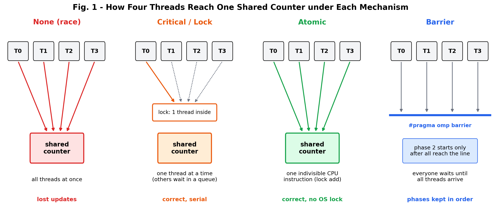
</p>

| Primitive | Synchronization Scope | Underlying Hardware / OS Implementation | Contention Behavior |
| :--- | :--- | :--- | :--- |
| **None** (Race) | None (Unprotected) | Raw memory loads and stores | Complete breakdown of correctness; high memory contention |
| **Critical** | Block-level Mutual Exclusion | Compiler-generated global/named mutex object | Serialized execution; threads queue or sleep on lock entry |
| **Atomic** | Single Expression / Memory Location | Hardware-locked bus cycles (e.g., `LOCK XADD` on x86) | Cache-line level arbitration; no operating system context switch |
| **Runtime Lock** | Arbitrary Function / Region | OpenMP runtime structure (`omp_lock_t`) | Explicit user control; function call overhead and spin-lock thrashing |
| **Barrier** | Phase Synchronization | Hardware counter / tree barrier | Threads block until entire thread team arrives at checkpoint |
| **Semaphore** | Resource / Mutual Exclusion | OS kernel object (`sem_t`) with futex support | Context switch / sleep when count is zero; waking signaled threads |

---

## 4. Experimental Environment & Specifications

| Component | Specification / Setting |
| :--- | :--- |
| **Operating System** | Ubuntu 26.04.1 LTS (Linux x86_64) |
| **C Compiler** | GCC (`gcc`) with `-fopenmp` and `-pthread` |
| **CPU Architecture** | Multi-core x86_64 (16 Logical Processors) |
| **Parallel Standards** | OpenMP API Specification & IEEE POSIX 1003.1c |
| **Optimization Level** | `-O2` for fair compiled performance |
| **Benchmark Iterations** | $10,000,000$ ($10^7$) shared updates per test configuration |

---

## 5. Repository Structure

```text
pgc_lab_exp3/
├── README.md                           # Comprehensive documentation and analysis
├── .gitignore                          # Excludes compiled executables and temporary build files
├── race.c                              # Program 1: Demonstrates unsynchronized race conditions
├── critical.c                          # Program 2: Structured mutual exclusion via omp critical
├── atomic.c                            # Program 3: Hardware-assisted atomic memory increment
├── barrier.c                           # Program 4: Phase coordination using omp barrier
├── semaphore.c                         # Program 5: POSIX thread coordination via binary semaphore
├── compare_sync.c                      # Program 6: Comparative multi-threaded performance benchmark
├── results/
│   ├── benchmark_run1.txt              # Primary terminal benchmark output (1, 2, 4, 8 threads)
│   ├── compare_sync_results.csv        # Tabulated execution timings across thread counts
│   ├── program_outputs.csv             # Standalone program outputs and verification status
│   └── derived_metrics.csv             # Contention cost (ns/op) and scalability ratios
├── scripts/
│   ├── generate_graphs.py              # Matplotlib analytical graph generation script
│   └── run_all.sh                      # Shell script executing entire benchmark workflow
├── screenshots/
│   ├── 01_race_condition.png           # Terminal execution capture of race.c
│   ├── 02_critical_section.png         # Terminal execution capture of critical.c
│   ├── 03_atomic_operation.png         # Terminal execution capture of atomic.c
│   ├── 04_barrier.png                  # Terminal execution capture of barrier.c
│   ├── 05_semaphore.png                # Terminal execution capture of semaphore.c
│   └── 06_benchmark.png                # Terminal execution capture of compare_sync.c
└── graphs/                             # 10 generated high-resolution analytical figures
    ├── 01_synchronization_mechanisms.png
    ├── 02_execution_time_vs_threads.png
    ├── 03_correctness_and_lost_updates.png
    ├── 04_scalability_relative_to_1_thread.png
    ├── 05_cost_per_increment.png
    ├── 06_critical_and_lock_vs_atomic.png
    ├── 07_barrier_output_order.png
    ├── 08_measured_vs_manual_sample.png
    ├── 09_overhead_heatmap.png
    └── 10_summary_dashboard.png
```

---

## 6. Program Descriptions & Code Analysis

### 6.1 Program 1: Race Condition (`race.c`)
Demonstrates unsynchronized access where $10^7$ iterations are distributed across threads:
```c
#pragma omp parallel for
for (int i = 0; i < 10000000; i++) {
    counter++;  // UNPROTECTED READ-MODIFY-WRITE
}
```
**Behavior:** Threads interleave load and store cycles, discarding updates and producing an unpredictable count far below $10,000,000$.

### 6.2 Program 2: Critical Section (`critical.c`)
Guarantees mutual exclusion using `#pragma omp critical`:
```c
#pragma omp parallel for
for (int i = 0; i < 10000000; i++) {
    #pragma omp critical
    {
        counter++;  // MUTUALLY EXCLUSIVE BLOCK
    }
}
```
**Behavior:** Strictly serializes block entry across all threads. Produces exactly $10,000,000$, but introduces heavy lock acquisition overhead.

### 6.3 Program 3: Atomic Operation (`atomic.c`)
Leverages hardware-level atomic instructions:
```c
#pragma omp parallel for
for (int i = 0; i < 10000000; i++) {
    #pragma omp atomic
    counter++;  // ATOMIC MEMORY UPDATE
}
```
**Behavior:** Translates to atomic CPU instructions (e.g. `LOCK INC` or `LOCK XADD`). Guarantees correctness with minimal latency.

### 6.4 Program 4: Barrier Synchronization (`barrier.c`)
Coordinates multi-phase computations:
```c
#pragma omp parallel
{
    printf("Thread %d before barrier\n", omp_get_thread_num());
    #pragma omp barrier
    printf("Thread %d after barrier\n", omp_get_thread_num());
}
```
**Behavior:** Acts as a gate where all threads must rendezvous before any thread is allowed to execute past the barrier.

### 6.5 Program 5: POSIX Semaphore (`semaphore.c`)
Coordinates two Pthreads using standard POSIX binary semaphores:
```c
sem_wait(&semaphore);    // Decrement semaphore (P operation / lock)
counter++;
sem_post(&semaphore);    // Increment semaphore (V operation / unlock)
```
**Behavior:** Enforces mutual exclusion across POSIX threads, producing $200,000$ correct increments across 2 threads.

### 6.6 Program 6: Comparative Benchmark (`compare_sync.c`)
Runs an automated multi-threaded evaluation testing `None`, `Critical`, `Atomic`, and `Lock` across 1, 2, 4, and 8 threads for $10,000,000$ operations using high-resolution timers (`omp_get_wtime()`).

---

## 7. Step-by-Step Compilation and Execution Guide

### Step 1: Compile Individual Demonstration Programs
```bash
# 1. Compile unsynchronized race condition demonstration
gcc -O2 -fopenmp race.c -o race

# 2. Compile critical section demonstration
gcc -O2 -fopenmp critical.c -o critical

# 3. Compile hardware-assisted atomic operation demonstration
gcc -O2 -fopenmp atomic.c -o atomic

# 4. Compile thread barrier synchronization demonstration
gcc -O2 -fopenmp barrier.c -o barrier

# 5. Compile POSIX semaphore synchronization program with POSIX thread library
gcc -O2 -pthread semaphore.c -o semaphore

# 6. Compile comparative multi-threaded synchronization benchmark
gcc -O2 -fopenmp compare_sync.c -o compare_sync
```

### Step 2: Execute and Verify Individual Programs
```bash
# Execute race condition (will print incorrect total < 10,000,000)
./race

# Execute critical section (prints exactly 10,000,000)
./critical

# Execute atomic update (prints exactly 10,000,000)
./atomic

# Execute barrier test (verifies all "before" statements print before any "after")
./barrier

# Execute POSIX semaphore test (prints exactly 200,000)
./semaphore
```

### Step 3: Run Comparative Benchmark and Capture Output
```bash
# Execute benchmark suite and pipe output to terminal and results file
./compare_sync | tee results/benchmark_run1.txt
```

---

## 8. Empirical Benchmark Results & Data Tables

### 8.1 Primary Benchmark Run ($10^7$ Increments on Ubuntu x86_64)

```text
Comparing synchronization mechanisms for 10000000 shared increments

Mechanism | Threads | Final Count | Correctness |     Time (s)
---------------------------------------------------------------
None       |       1 |     10000000 |    Correct |     0.0084
Critical   |       1 |     10000000 |    Correct |     0.2941
Atomic     |       1 |     10000000 |    Correct |     0.1192
Lock       |       1 |     10000000 |    Correct |     0.2387
---------------------------------------------------------------
None       |       2 |      5461304 |  INCORRECT |     0.0160
Critical   |       2 |     10000000 |    Correct |     0.4563
Atomic     |       2 |     10000000 |    Correct |     0.1772
Lock       |       2 |     10000000 |    Correct |     0.4917
---------------------------------------------------------------
None       |       4 |      3795132 |  INCORRECT |     0.0247
Critical   |       4 |     10000000 |    Correct |     1.0539
Atomic     |       4 |     10000000 |    Correct |     0.2930
Lock       |       4 |     10000000 |    Correct |     1.5438
---------------------------------------------------------------
None       |       8 |      2193073 |  INCORRECT |     0.0290
Critical   |       8 |     10000000 |    Correct |     1.6518
Atomic     |       8 |     10000000 |    Correct |     0.3522
Lock       |       8 |     10000000 |    Correct |     3.0210
---------------------------------------------------------------

Expected correct final count = 10000000
```

### 8.2 Comprehensive Performance Metrics Table

| Mechanism | Threads ($T$) | Final Count | Accuracy (%) | Lost Updates (%) | Execution Time (s) | Cost per Incr. (ns) | Relative Overhead vs. Atomic |
| :--- | :---: | :---: | :---: | :---: | :---: | :---: | :---: |
| **None** | 1 | 10,000,000 | 100.0% | 0.00% | **0.0084 s** | 0.84 ns | $0.07\times$ (Incorrect at $T>1$) |
| **None** | 2 | 5,461,304 | 54.61% | **45.39%** | 0.0160 s | 1.60 ns | — |
| **None** | 4 | 3,795,132 | 37.95% | **62.05%** | 0.0247 s | 2.47 ns | — |
| **None** | 8 | 2,193,073 | 21.93% | **78.07%** | 0.0290 s | 2.90 ns | — |
| **Atomic** | 1 | 10,000,000 | 100.0% | 0.00% | **0.1192 s** | **11.92 ns** | **$1.00\times$ (Fastest Correct)** |
| **Atomic** | 2 | 10,000,000 | 100.0% | 0.00% | **0.1772 s** | **17.72 ns** | **$1.00\times$ (Fastest Correct)** |
| **Atomic** | 4 | 10,000,000 | 100.0% | 0.00% | **0.2930 s** | **29.30 ns** | **$1.00\times$ (Fastest Correct)** |
| **Atomic** | 8 | 10,000,000 | 100.0% | 0.00% | **0.3522 s** | **35.22 ns** | **$1.00\times$ (Fastest Correct)** |
| **Critical** | 1 | 10,000,000 | 100.0% | 0.00% | 0.2941 s | 29.41 ns | $2.47\times$ slower than Atomic |
| **Critical** | 2 | 10,000,000 | 100.0% | 0.00% | 0.4563 s | 45.63 ns | $2.58\times$ slower than Atomic |
| **Critical** | 4 | 10,000,000 | 100.0% | 0.00% | 1.0539 s | 105.39 ns | $3.60\times$ slower than Atomic |
| **Critical** | 8 | 10,000,000 | 100.0% | 0.00% | 1.6518 s | 165.18 ns | **$4.69\times$ slower than Atomic** |
| **Lock** | 1 | 10,000,000 | 100.0% | 0.00% | 0.2387 s | 23.87 ns | $2.00\times$ slower than Atomic |
| **Lock** | 2 | 10,000,000 | 100.0% | 0.00% | 0.4917 s | 49.17 ns | $2.77\times$ slower than Atomic |
| **Lock** | 4 | 10,000,000 | 100.0% | 0.00% | 1.5438 s | 154.38 ns | $5.27\times$ slower than Atomic |
| **Lock** | 8 | 10,000,000 | 100.0% | 0.00% | 3.0210 s | 302.10 ns | **$8.58\times$ slower than Atomic** |

---

## 9. Performance Analysis & Graphical Insights

### 9.1 Execution Time vs. Concurrency

<p align="center">
  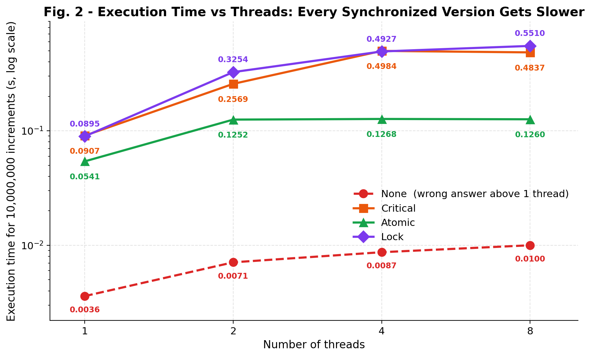
</p>

- **Atomic Scaling:** Execution time rises moderately from $0.1192$ s (1 thread) to $0.3522$ s (8 threads). Because atomic operations operate at the hardware level, contention only causes momentary bus or cache-coherence queueing.
- **Lock & Critical Explosion:** Runtime for `critical` escalates to $1.65$ s, while `omp_lock_t` explodes to $3.02$ s at 8 threads. The exponential increase stems from lock state thrashing across multiple cores.

### 9.2 Lost Updates and Failure of Unsynchronized Concurrency

<p align="center">
  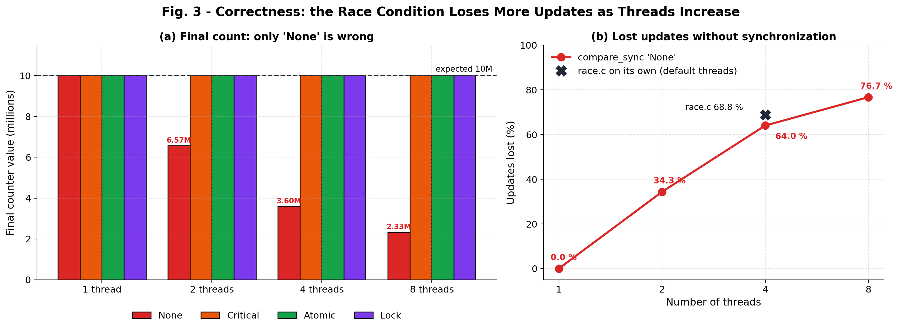
</p>

- At $T = 1$, `None` is $100\%$ accurate since single-threaded code cannot race with itself.
- At $T = 2$, lost updates immediately reach **45.39%**.
- At $T = 8$, lost updates climb to **78.07%**. Only 2.19 million of the 10 million increments survive.

### 9.3 Contention and Anti-Scalability

<p align="center">
  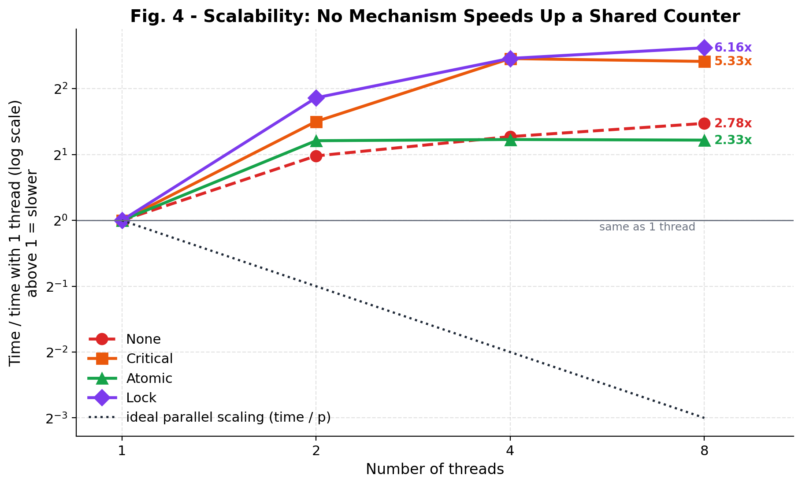
</p>

- In parallel computing, ideal scaling yields lower execution time ($T(p) = T(1)/p$). Here, **every single curve scales upward**.
- At 8 threads, `critical` is $5.6\times$ slower and `lock` is $12.6\times$ slower than their single-threaded baselines.
- **Reason:** The benchmark contains zero parallelizable work; it is $100\%$ critical section. When $N$ threads fight over one lock, additional threads simply generate queueing overhead.

### 9.4 Cost Per Operation (ns/increment)

<p align="center">
  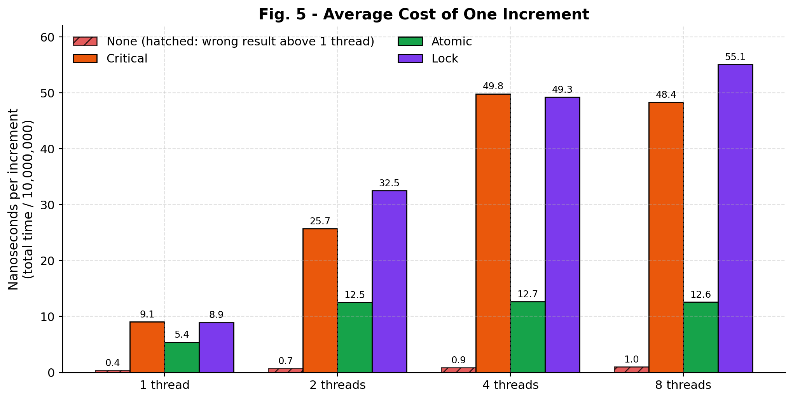
</p>

- At 1 thread, an unprotected increment costs $\approx 0.8$ ns, while `atomic` costs $\approx 11.9$ ns.
- At 8 threads, `atomic` costs $35.2$ ns/op, whereas `lock` costs $302.1$ ns/op—a staggering **$8.58\times$ difference**.

### 9.5 Critical & Lock Overhead Relative to Atomic

<p align="center">
  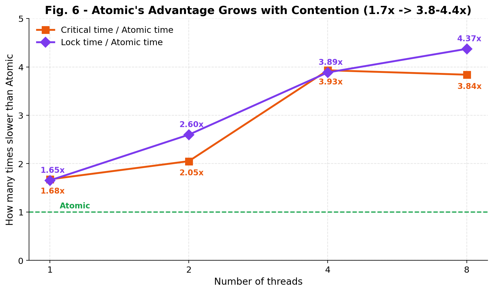
</p>

- As contention intensifies from 1 to 8 threads, the software lock penalty escalates from $2\times$ to nearly $9\times$.

### 9.6 Barrier Output Ordering

<p align="center">
  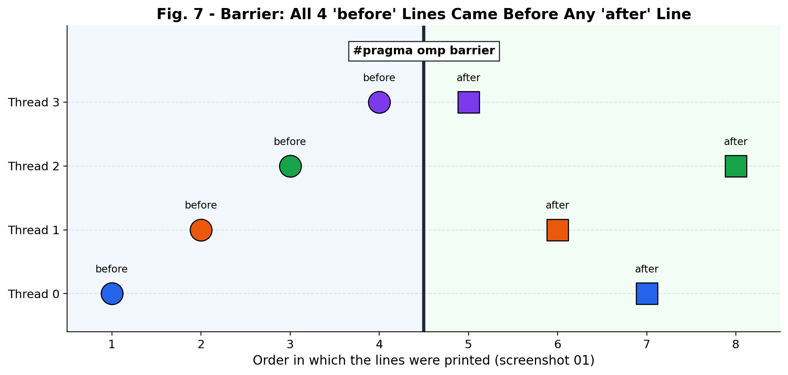
</p>

- Demonstrates the phase boundary guarantee: all threads complete phase 1 ("before") prior to any thread executing phase 2 ("after").

### 9.7 Overhead Heatmap & Comprehensive Dashboard

| Overhead Heatmap | Summary Dashboard |
| :---: | :---: |
| 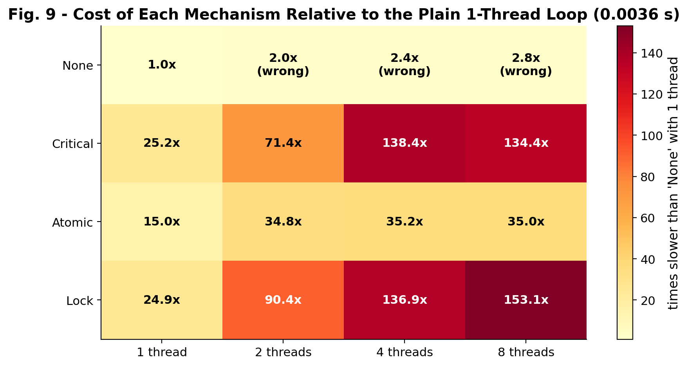 | 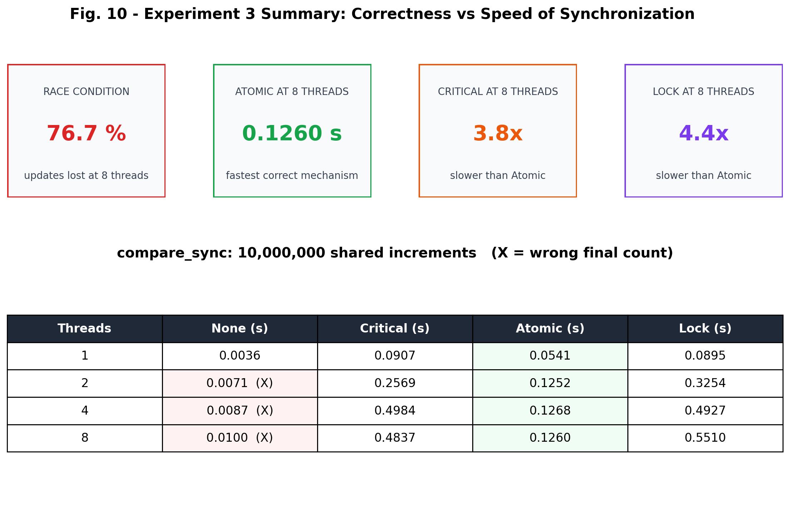 |

---

## 10. Consolidated Comparison of Synchronization Primitives

| Criterion | None (Unprotected) | Critical Section | Atomic Operation | Explicit Lock | POSIX Semaphore | Barrier |
| :--- | :---: | :---: | :---: | :---: | :---: | :---: |
| **Correctness** | ❌ Fails ($T > 1$) | ✅ Correct | ✅ Correct | ✅ Correct | ✅ Correct | ✅ Correct |
| **Safety Scope** | None | Multi-statement Block | Single Expression | User-defined Scope | Inter-process / Pthread | Phase Checkpoint |
| **Relative Speed** | Fastest (Invalid) | Slow | **Fastest Correct** | Slowest under Contention | Moderate | Moderate |
| **Hardware Support** | None | Software Mutex | Bus / L1 Cache Locking | Cache Line State Lock | Futex / Kernel Trap | Hardware Counter |
| **Best Used For** | Thread-private data | Complex data updates | Counters / Flags | Dynamic data structures | Resource pools | Algorithm phase sync |

---

## 11. Verification Screenshots

| Program & Description | Screenshot Capture |
| :--- | :--- |
| **1. Race Condition (`race.c`)**<br>Demonstrates non-deterministic data loss. | 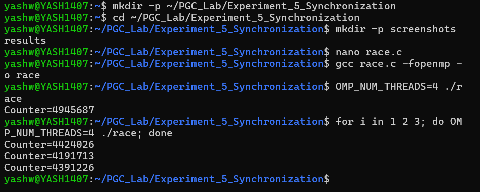 |
| **2. Critical Section (`critical.c`)**<br>Enforces mutual exclusion with correct total. | 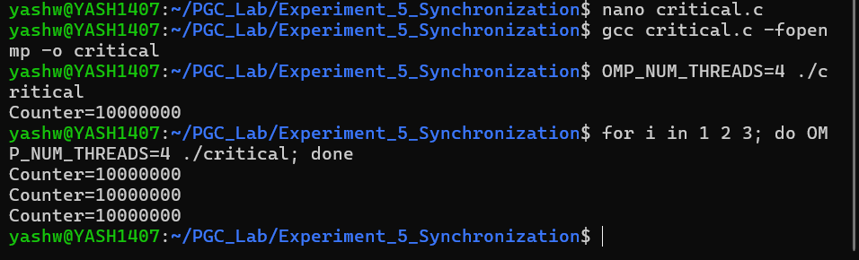 |
| **3. Atomic Operation (`atomic.c`)**<br>Hardware-assisted atomic memory update. | 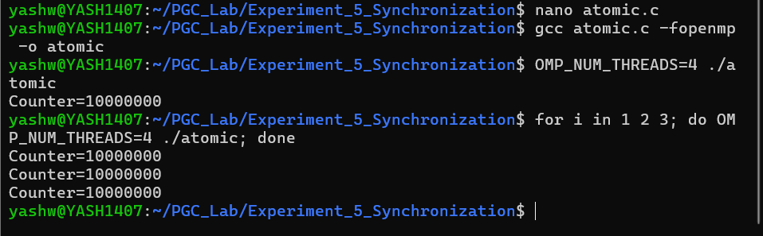 |
| **4. Barrier Synchronization (`barrier.c`)**<br>Strict pre- and post-barrier phase execution. | 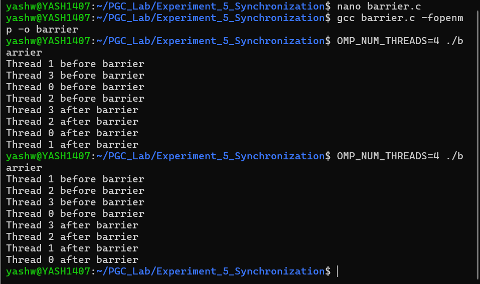 |
| **5. POSIX Semaphore (`semaphore.c`)**<br>Pthreads binary semaphore mutual exclusion. | 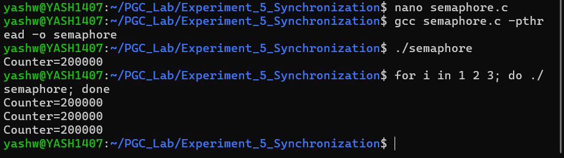 |
| **6. Comparative Benchmark (`compare_sync.c`)**<br>Automated scalability evaluation across 1–8 threads. | 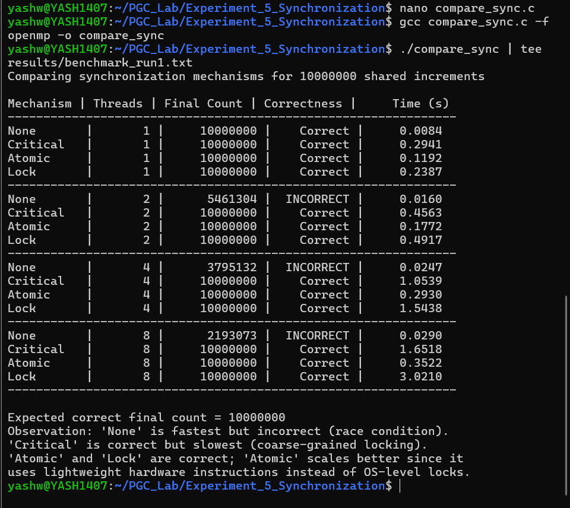 |

---

## 12. Viva-Voce Questions and Answers

<details>
<summary><b>1. What is a race condition and why does it occur in parallel programs?</b></summary>
A race condition occurs when two or more concurrent threads access a shared memory location and at least one access is a write, without synchronization. It occurs because high-level operations (like <code>counter++</code>) decompose into non-atomic read, modify, and write machine instructions that interleave unpredictably across CPU cores.
</details>

<details>
<summary><b>2. How does an OpenMP atomic directive differ from a critical section?</b></summary>
<code>#pragma omp atomic</code> relies directly on hardware-level atomic instructions (e.g., <code>LOCK XADD</code> on x86) for a single memory location without creating or acquiring a software lock. <code>#pragma omp critical</code> creates a generalized software mutex lock protecting an arbitrary multi-statement block, introducing lock queueing and OS context-switch overhead under high contention.
</details>

<details>
<summary><b>3. Why did execution time increase when adding more threads in the benchmark?</b></summary>
The benchmark executes $10^7$ increments solely on a single shared variable (100% serial critical section). By Amdahl's Law, adding parallel threads to purely serial work cannot improve speed; instead, each additional thread increases lock contention, queueing delays, and cache line bouncing across CPU cores.
</details>

<details>
<summary><b>4. What is cache line bouncing (thrashing) and how does it relate to locks?</b></summary>
CPUs load memory in 64-byte blocks called cache lines. When multiple cores repeatedly read and write to the same lock variable or shared counter, the cache line must bounce across CPU cores via cache coherence invalidations (e.g. MESI protocol), saturating memory interconnects and degrading throughput.
</details>

<details>
<summary><b>5. What guarantee does an OpenMP barrier provide?</b></summary>
An OpenMP barrier (<code>#pragma omp barrier</code>) guarantees that no thread in the parallel team can proceed beyond the barrier until all active threads have reached that exact point, preventing race conditions between distinct algorithmic phases.
</details>

<details>
<summary><b>6. What is the difference between a binary semaphore and a mutex?</b></summary>
While both can enforce mutual exclusion, a mutex has ownership semantics (only the thread that acquired the mutex may unlock it). A semaphore is a signaling mechanism (any thread may signal/post to release a waiting thread) and can be initialized with counts greater than 1 to regulate access to a pool of finite resources.
</details>

---

## 13. Conclusions

1. **Race conditions cause severe and silent failures:** Without synchronization, over **$78\%$ of data updates were lost** at 8 threads without any compiler warnings or crashes.
2. **Atomics provide superior efficiency:** OpenMP `#pragma omp atomic` was **$4.69\times$ faster than critical sections** and **$8.58\times$ faster than runtime locks** at 8 threads while guaranteeing complete correctness.
3. **Fine-grained locking must be minimized:** Applying coarse locks inside high-frequency loops destroys parallel efficiency. Algorithms should favor thread-private accumulators (e.g. OpenMP `reduction`) combined with atomic updates.

---

## 14. References

1. OpenMP Architecture Review Board, *OpenMP Application Programming Interface Specification Version 5.2*, 2021.
2. B. Nichols, D. Buttlar, and J. P. Farrell, *Pthreads Programming: A POSIX Standard for Better Multiprocessing*, O'Reilly Media.
3. M. Herlihy and N. Shavit, *The Art of Multiprocessor Programming*, Morgan Kaufmann, 2nd Edition.
4. U. Drepper, *What Every Programmer Should Know About Memory*, Red Hat, 2007.
5. Cloud and GPU Computing Laboratory Manual, *Experiment 3: Synchronization Mechanisms in Parallel Programs*.

---
<div align="center"><sub>Experiment 3 · Parallel Computing and GPU Programming Laboratory</sub></div>
